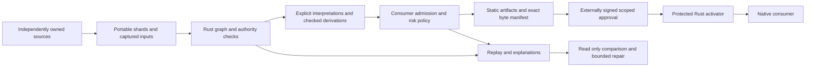

# Rust correspondence compiler build plan

Date: 2026-10-10. Working name: **Bindloom**, provisional. Status: proposed architecture and implementation sequence. This plan prepares a separate Rust project; it does not change MetaMap's implementation or authorize a release or production activation.

Build a Rust compiler for trustworthy relationships between independently owned systems. Preserve MetaMap's central purpose: **give networks and configurations stable semantic names, explicit bindings, and checked generated structures, analogous to variables and bindings in a program.** The new project should implement that purpose directly, with the full lifecycle designed before its first wire contracts are published.

The product promise is observable: a consumer refers to a semantic identity; an owner changes the implementation behind that identity; recompilation produces the correct native binding, or explains why the binding cannot be used. Ownership, evidence, admissibility, authorization and active state remain distinct throughout.

## Name and relationship to Hypermaps

Use **Bindloom** as a working name, described as **a correspondence compiler for independently owned systems**. It emphasizes binding and composition without implying a global map or a universal ontology. A limited exact-name search of indexed web, GitHub, crates.io and npm pages returned no results on 2026-10-10. This is a preliminary collision check, not confirmation of package, domain or brand availability. Resolve the final name and protocol namespace before publishing contracts.

[Hypermaps.org](https://hypermaps.org/) describes an open geospatial protocol and shared knowledge graph for information about places, including attributed claims, provenance, freshness and confidence. That overlaps with MetaMap in representing relationships and keeping evidence attributable. Its stated focus is a shared context layer for the physical world. MetaMap's focus is deciding which correspondences a particular consumer may trust and compiling those into executable structures.

The homepage does not establish whether Hypermaps has comparable composition rules, fact-scoped authority, admission gates or protected activation. Those details remain unknown. The overlap is sufficient to make “Hypermaps” a confusing name for this successor; it does not establish that the two projects implement the same mechanism or that either has a priority claim over the other.

## Reference baseline and lessons

Pin MetaMap's verified engine at `399747a4ad05a37cd8db1cedd53048fad2175be4`. Its closing build record is at `6a6a9d2415df85504a83fce4fd7291d0391c0d17`; the intervening change affects only `BUILD_PLAN.md`.

The reference sources are:

- [Vision](https://github.com/roryscot/metamap/blob/399747a4ad05a37cd8db1cedd53048fad2175be4/VISION.md): product direction and scope limits.
- [Architecture](https://github.com/roryscot/metamap/blob/399747a4ad05a37cd8db1cedd53048fad2175be4/ARCHITECTURE.md): identity, locators, ownership, linking and consumer boundaries.
- [Contract decisions](https://github.com/roryscot/metamap/blob/399747a4ad05a37cd8db1cedd53048fad2175be4/CONTRACTS.md): compatibility and semantic input binding.
- [Completed build record](https://github.com/roryscot/metamap/blob/6a6a9d2415df85504a83fce4fd7291d0391c0d17/BUILD_PLAN.md): implemented scope, actual acceptance and retained failures.
- [Governance](https://github.com/roryscot/metamap/blob/399747a4ad05a37cd8db1cedd53048fad2175be4/GOVERNANCE.md), [activation](https://github.com/roryscot/metamap/blob/399747a4ad05a37cd8db1cedd53048fad2175be4/ACTIVATION.md) and [lifecycle](https://github.com/roryscot/metamap/blob/399747a4ad05a37cd8db1cedd53048fad2175be4/LIFECYCLE.md): exact approvals and actual deployment boundaries.
- [Replay](https://github.com/roryscot/metamap/blob/399747a4ad05a37cd8db1cedd53048fad2175be4/REPLAY.md), [counterfactuals](https://github.com/roryscot/metamap/blob/399747a4ad05a37cd8db1cedd53048fad2175be4/COUNTERFACTUAL.md) and [scientific mapping](https://github.com/roryscot/metamap/blob/399747a4ad05a37cd8db1cedd53048fad2175be4/SCIENTIFIC_MAPPING.md): replay limits, attribution limits and source-preserving integration.

MetaMap is more than an early graph prototype. Its current build record reports completed relation-law checks, typed uncertainty and budgets, authenticated governance, a protected Linux profile, bounded repair, a local debugger, scientific integration and a tested consumer lifecycle. Rebuilding should retain those lessons rather than repeat the older gap assessment.

| Lesson from MetaMap | Decision for the Rust project |
| --- | --- |
| Stable IDs must survive locator changes | Treat identity and physical binding as separate concepts in the first model and first example |
| Recognition, admission and deployment require different evidence | Give each transition a distinct API and result state |
| Versioned sidecars accumulated around an existing implementation | Design one coherent initial lifecycle vocabulary; add records only where they have an independent purpose |
| Cross-language hashing has subtle edge cases | Specify canonical bytes before signatures, replay or caches depend on them |
| Self-supplied trust proves little about a protected consumer | Obtain current trust, baseline and clock from the installed host |
| The TypeScript Linux profile uses a separate locking process | Hold a native operating-system lock through the Rust activation transaction |
| Failed consumers used as change seeds obscured producer paths | Keep changed inputs, failing obligations and dependency paths distinct from the beginning |
| Rejected projections have no meaningful runtime or risk delta | Preserve unavailable results explicitly rather than reporting zero or improvement |
| Source confidence does not establish typed support or probability | Retain original confidence metadata and require explicit consumer evidence policy |
| SIGKILL checks and memory tests establish different things | Verify the real permission boundary and crash phases separately; limit durability claims |
| Passing package tests inside the checkout can miss distribution failures | Install released candidates into clean consumers and execute their generated artifacts |

The strongest objection to a rebuild is semantic regression: a cleaner Rust implementation could reproduce old mistakes, lose important guards, or disagree with MetaMap in ways ordinary unit tests miss. A normative specification, independent expectations and a classified differential corpus are therefore required before replacement. Faster compilation, smaller footprints and improved reliability are hypotheses until measured; the build is justified first by its native distribution and explicit implementation boundaries.

## Scope and deliverables

The initial project delivers a Rust library and native CLI, portable versioned documents, JSON and native Rust/TypeScript projections, captured replay, structured explanations, typed uncertainty and consumer budgets, externally authenticated approvals, a protected Linux activator, bounded repair proposals, thin language integrations, and one scientific mapping profile.

Adapters remain separate programs or libraries that emit portable source shards. A TypeScript source adapter may still use the TypeScript compiler API. The semantic compiler and Linux activator must run without Node installed when given portable inputs.

Start with software relationships and configurations. Support independently authored shards and relation packs, without requiring a hosted federation service. Organizational semantic memory is represented through versioned declarations, owner scopes, dependency traces and comparisons. Broader scientific formats and relation-pack distribution can follow the first validated integration.

Keep comparative time-saving and reviewer-effort studies deferred. Functional acceptance must still include valid controls and meaningful refusals. A system that rejects every candidate does not satisfy the product purpose. No superiority claim is inferred from matching MetaMap's tests.

Universal ontology construction, arbitrary executable relation packs, unrestricted theorem proving, automatic repair application, production key custody, a hosted collaboration service and physical-information theories are outside this build. Production installation, owner grants and consumer activation remain explicit adoption decisions.

## Architecture



Use a small Cargo workspace. Establish these boundaries before adding more crates:

| Component | Responsibility | Boundary |
| --- | --- | --- |
| contracts | Untrusted wire records, strict parsing, canonical encoding and version dispatch | Parsed data carries no checked or authorized status |
| core | Graph checks, fact ownership, derivation, admission, uncertainty, dependency traces and replay | Deterministic computation; no network, process execution, hidden clock or activation writes |
| projection | Checked slot resolution and JSON/Rust/TypeScript emitters | Consumes admitted state; emits no authority of its own |
| cli | File I/O, explicit adapter invocation, commands and human presentation | Delegates every semantic decision to the library |
| governance | Exact proposal deltas, signature verification and scoped grants | Pure verification against externally supplied current host context |
| activator | Linux permission checks, native locking, durable staging and publication | Small protected host boundary; fixed installation and trusted configuration |
| conformance | MetaMap comparison driver, independent fixtures and protocol vectors | Test tooling; outside the production dependency path |

Keep related algorithms as modules rather than creating a crate for every feature. Add governance and the activator only when their milestones begin. The CLI, SDKs and debugger must not implement alternative policy engines.

Represent `ParsedCandidate`, `CheckedGraph`, `CheckedDerivation`, `AdmittedGeneration`, `CheckedProjection` and `AuthorizedChange` as distinct internal types with private fields and controlled constructors. Do not derive public deserialization or expose unchecked constructors for checked states. Persist wire records and revalidate them on ingress. Include the exact context and input bindings in every checked state.

[Rust's typestate pattern](https://docs.rust-embedded.org/book/static-guarantees/typestate-programming.html) can constrain which operations an API permits. It cannot establish the truth of a mapping or keep an approval valid after trust or time changes. The protected activator must repeat current authorization checks at publication even if it receives an internally authorized value.

Forbid project-authored unsafe code in the pure kernel. Prefer safe operating-system wrappers in the activator; isolate and document any unavoidable unsafe boundary. Safe Rust does not eliminate application-level races, filesystem substitution, malicious inputs or mistakes in relation semantics. [Rust's unsafe-code guidance](https://doc.rust-lang.org/book/ch20-01-unsafe-rust.html) explains the distinction between compiler-enforced guarantees and obligations at unsafe boundaries.

## Protocol and compatibility decisions

Use JSON as the first portable boundary. Define one explicit version-dispatched envelope family for source shards, relation packs, consumer policies, evaluations, projections, proposals, approvals and activation receipts. A coherent family does not mean placing everything into one enormous record. Shared identifiers, digest rules, diagnostics and lifecycle states should have one definition.

Use RFC 8785 canonical UTF-8 JSON and SHA-256 for newly addressed payloads. Reject duplicate decoded member names, invalid Unicode, unsupported versions, unknown fields outside declared extension points, and over-limit inputs. Specify which collections have set semantics and which preserve order. Define absent versus null, negative zero, finite numbers, safe integer limits and exact timestamp syntax.

Do not assume Rust's ordinary string sorting or JSON serializer produces JCS. [RFC 8785](https://www.rfc-editor.org/rfc/rfc8785) requires UTF-16 property ordering and ECMAScript-compatible number serialization. Integer costs and counters should use checked arithmetic within the protocol's interoperable range; oversized values reject. Preserve a source's original scientific numeric text where faithful metadata round-tripping requires it.

Keep stable semantic identity separate from revision and content digest. An assertion's identity policy must be explicit: changing an anonymous content-derived assertion may create a new ID; an explicitly named assertion may retain its ID with a new revision. Never derive output filenames directly from semantic IDs or input locators.

Compatibility has four separately tested meanings:

1. **Shared semantics:** admission decisions, binding selection, law results, uncertainty states, risk closure and normalized diagnostic origins agree for the declared shared profile.
2. **Shared encoding:** identical canonical semantic payloads produce identical bytes and digests where the compatibility profile explicitly requires that agreement.
3. **Native behavior:** emitted artifacts typecheck and execute correctly in each target language; newly generated Rust source need not resemble TypeScript source.
4. **Historical execution:** a MetaMap replay remains bound to its captured TypeScript executor. Rust recompilation is a new evaluation, not a claim that the historical executor ran.

Rust build identity and new protocol envelopes will differ from MetaMap. Record those differences instead of removing arbitrary provenance fields to make comparisons pass. Maintain an explicit comparison projection and a registry of intentional differences, each with an independently stated expected outcome.

Use MetaMap as a reference implementation, not an infallible oracle. Shared bugs must be caught by independently specified controls, protocol vectors and adversarial cases. Any intentional tightening or semantic change requires a contract decision and a regression fixture. Importing an old graph or policy must produce a migration report; old approvals cannot authorize a new protocol, compiler artifact set or active baseline.

## Milestones and dependency order

| Milestone | Deliverable | Dependencies | Acceptance gate |
| --- | --- | --- | --- |
| R0 | Charter, normative semantics, protocol decisions and frozen corpus | Reference intake | Every vision element and applicable MetaMap case has an implementation and acceptance destination |
| R1 | Strict contracts and pure Rust kernel | R0 | Invalid graphs and ownership reject; checked states cannot be constructed through public unchecked APIs |
| R2 | Stable binding vertical slice | R1 | Two independent source owners generate working Rust and TypeScript consumers across an implementation move |
| R3 | Capture, replay, differential checks and explanations | R1, R2 | Successful and rejected evaluations reproduce offline with honest executor and source limits |
| R4 | Relation laws and checked derivations | R1, R3 | Allowed compositions produce inspectable derivations; invalid or unsupported inferences cannot enter executable output |
| R5 | Typed uncertainty and consumer risk budgets | R2, R4 | Consumer-specific tolerances and complete unique dependency costs determine projection admission |
| R6 | Authenticated governance and AI boundaries | R3, R5 | Exact owner-scoped approvals authorize permitted deltas; agents cannot self-approve protected changes |
| R7 | Native Linux protected activation | R6 | Real independent-UID denial, concurrent stale-base handling and crash-phase recovery pass |
| R8 | Counterfactual repair and semantic debugger | R3–R6 | Read-only explanations and finite repair search preserve unknowns and never imply application or approval |
| R9 | Adapter protocol, thin SDKs and installation | R2, R3; R6/R7 for governed calls | Clean consumers use the native compiler without duplicated semantics or a Node dependency in the core |
| R10 | Source-preserving scientific integration | R3–R5, R9 | Pinned SSSOM and RO-Crate profile checks preserve assertions and metadata and pass independent conformance |
| R11 | Complete lifecycle, migration pilot and release candidate | R0–R10 | Exact packaged revision passes the full vision acceptance matrix and a separate consumer migration |

R0–R3 form a developer preview of the useful abstraction. R4–R7 add the checked semantic and deployment boundaries. R8–R11 complete the requested successor scope. A preview cannot advertise the protected activation guarantees of an unfinished milestone.

### R0 Establish the specification and fixed controls

Create a project charter, normative semantic specification, protocol/digest specification, deployment threat model, migration policy and conformance manifest. Pin the Rust toolchain and dependency lockfile; choose the license with MetaMap's Apache-2.0 reuse and notice obligations in view.

Inventory the relevant MetaMap tests and fixtures. Classify each as shared-profile conformance, legacy-only migration, host-profile acceptance, intentionally changed behavior or an independent control. Cover every applicable invariant rather than reproducing the TypeScript test count. Preserve original negative pilot results, raw scientific fixtures and published schemas.

Freeze cases for valid moves, missing and ambiguous bindings, scoped delegation, authority expansion, permitted and forbidden compositions, required unknown evidence, budget boundaries, tampered artifacts, stale approval and baseline, rollback, rejected replay, repair exhaustion and scientific duplicate assertions. Each case states its expected result without deriving it from the new implementation.

**Acceptance:** all seven requested vision elements map to milestones and cases; no unresolved decision changes signed bytes, semantic identity or the trust boundary. Toolchain/package choices and resource limits are explicit before dependent implementation starts.

### R1 Implement the pure kernel

Implement strict parsing into untrusted records, stable ID indexes, shard composition, reference resolution, relation endpoint checks, coverage rules, locator conflicts and deterministic diagnostics. Implement fact-scoped canonical ownership and delegation with narrowing, cycle checks and overlapping-branch rejection.

Use explicit evaluation context and time. Establish input-size, graph-size, nesting, traversal and diagnostic limits. Capture dependency and obligation edges while evaluating, so explanations do not need to guess them later. Build a public API that makes unchecked-to-checked transitions visible.

**Acceptance:** malformed and ambiguous inputs reject deterministically; valid independent shards compose; ownership is scoped to facts; input iteration order cannot change results where order has no semantic meaning. Compile-fail examples demonstrate that downstream callers cannot forge checked states through ordinary safe public APIs. The kernel operates without filesystem, network or clock access.

### R2 Prove stable bindings in native consumers

Build a small route/service configuration owned by two independent sources. Use explicit semantic IDs, handler or endpoint locators, projection specifications and named relation slots. Implement exact cardinality, kind and loss constraints, then JSON, TypeScript and Rust emitters.

Move an actual handler implementation and change its locator while retaining the semantic identity. Recompile and execute both consumers. Exercise changed policy targets as visible semantic deltas, not merely text differences. Runtime lookup uses generated native structures and does not call the compiler.

**Acceptance:** unchanged semantic references resolve after the move; missing or ambiguous handlers reject; target-kind mismatches and disallowed lossy links reject. Both target languages compile and execute their generated bindings. The native CLI performs this flow from portable inputs on a host without Node. Activation remains a later milestone.

### R3 Make evaluations reproducible and explainable

Capture complete semantic inputs, exact pack contents, evidence and assessment records, projection specifications, evaluation context/time, source receipts, executor identity and both successful and rejected outputs. Separate semantic output identity from the evaluation receipt's executor attribution according to the R0 contract.

Replay reads captured data and the installed matching executor. It never fetches sources or loads code named by a bundle. Distinguish reproducible compiler evaluation from reproducing source discovery: the latter needs the relevant captured source bytes and adapter implementation. A digest alone cannot reconstruct a missing source.

Add an isolated differential harness using the pinned MetaMap engine. Compare the declared shared semantic profile, canonical payloads and normalized diagnostics. Keep complete original outputs alongside classified differences.

**Acceptance:** valid and rejected captures reproduce; corrupted inputs, missing dependencies and incompatible executors fail explicitly. A changed producer leads to its failed obligations through recorded paths; the failed consumer is not fabricated as a changed input. Reports preserve unavailable projection and risk deltas. Every unexplained differential disagreement blocks the relevant capability gate.

### R4 Execute a bounded relation language

Implement a finite declarative law vocabulary with explicit operand roles, allowed endpoint kinds, result relations, conditions, loss/reversibility rules and proof requirements. Preserve n-ary correspondence structure. Keep shard merging separate from logical composition.

Check requested derivations against exact premise revisions, pack contents, context and declared depth/count limits. Store rule applications and premise dependencies. Unsupported operations return an explicit unsupported result; resource exhaustion returns incomplete. Connectivity, similar names or a path through the graph must never establish identity by themselves.

**Acceptance:** independently specified allowed chains pass; role reversal, stale premises, incompatible contexts, unsupported properties and invalid loss/reversal reject. `closeMatch` cannot become transitive equivalence. Derivations cannot transfer ownership or deployment authority. All generated projections recheck the proofs they use. Reported proof means a checked application of declared laws, not independently proven truth of source assertions.

### R5 Implement uncertainty and risk accounting

Preserve MetaMap's identity, context, provenance, completeness, causal relevance and conflicting-authority dimensions. Represent supported, contradicted, unknown and reasoned not-applicable states explicitly. Bind assessments to evidence, assessors, source revisions and named measurement models.

Specify conservative propagation. Unknown premises remain unknown; conflicting evidence remains visible; incompatible measurement models cannot be averaged into certainty. Scalar source confidence remains metadata unless an explicit validated model defines how to interpret it.

Compute consumer-specific ordinal costs over the complete unique set of mappings and premises used by a projection. Require complete classification, checked integer arithmetic and separate lossy/inferred limits. Include inactive and unused mappings only where the contract expressly requires them; never charge a shared premise twice.

**Acceptance:** the same graph can pass one consumer and fail a stricter one. Below/at/above-budget controls pass their stated expectations. Missing assessments are not zero risk; direct support cannot erase an unknown premise. A rejected projection has an unavailable cost result rather than an invented improvement. Ordinal cost is not presented as probability of failure.

### R6 Authenticate exact changes

Implement proposals, complete artifact inventories, delta/action requirements and domain-separated external signatures. The host supplies current principals, keys, fact/action grants, revocations, validity intervals, consumer/environment, baseline and trusted time. Graph ownership and proposer attribution cannot appoint signing authority.

Use a maintained Ed25519 implementation and standard vectors, with explicit key/signature encoding and strict verification policy. [ed25519-dalek](https://docs.rs/ed25519-dalek/latest/ed25519_dalek/struct.VerifyingKey.html) exposes strict verification, including rejection of weak keys; select and pin an approved version at implementation time. Test interoperable signatures independently rather than implementing cryptography.

Bind approval to exact inputs, compiler/profile identity, selected projections, native file bytes, baseline, trust configuration, actions and scopes. Bootstrap, rollback, authority changes, law changes and policy/budget relaxation require an externally configured owner role and matching grants. Agent permissions may allow ordinary implementation rebinding only within the explicitly delegated scope.

**Acceptance:** forgery, expiry, revocation, wrong consumer/environment, incomplete grants, swapped output bytes, changed inputs and stale baselines reject. A viable AI-proposed authority expansion remains a proposal. Ordinary waivers cannot suppress authentication failures. Private signing keys remain outside the compiler and activation request.

### R7 Implement the protected Linux host

Ship a fixed Rust activator installed outside proposer-writable directories. Start with a specified root-owned Linux/local-filesystem profile and a separate unprivileged proposer UID. The wrapper fixes binary, configuration, environment and permitted request transport. Incoming requests cannot choose trust files, clock, executables, runtime installation or state roots.

Hold a native operating-system lock through baseline reads, current trust checks, staging, final authorization and publication. Specify administration of trust under the same serialization protocol. Use descriptor-relative/no-follow operations and ownership/type/link checks to prevent path substitution. Stage complete immutable artifacts, sync files and directories, bind an immutable manifest, then atomically replace one active pointer on the same filesystem.

Recheck actual bytes, current baseline, trust and time immediately before publication. Readers must consume one complete addressed generation. Preserve the previous active state on pre-publication rejection. Post-publication durability or response failures return indeterminate and require reconciliation against protected state.

**Acceptance:** an actual separate UID cannot alter trust, runtime, lock, manifest, pointer or active files. Concurrent proposals cannot both activate against the same stale baseline. Native consumers read complete old or new generations. Real SIGKILL tests cover locked, artifacts-ready, manifest-ready, before-commit and committed phases. Retrying requires current authorization; rollback is a freshly approved change against the current baseline.

Memory tests do not satisfy this gate. SIGKILL tests do not establish power-loss durability. Other operating systems and network filesystems remain unsupported for protected activation until their own permissions and transaction acceptance pass.

### R8 Add bounded repair and semantic debugging

Compare explicit candidates using captured inputs and the shared explanation engine. Report changed origins, affected obligations, proof differences, evidence/uncertainty changes, risk, exact projected bindings and approval requirements. Provide CLI inspection first, then an offline local debugger.

Search only a declared finite edit space, with explicit limits and deterministic ranking. Recompile every candidate using the same kernel. Report rejected and protected edits, remaining failures, attempted/unexamined combinations, exhaustion and approval requirements. Claim minimality only within a fully explored declared search space.

**Acceptance:** search and debugger perform no source or activation writes. Repair does not invent evidence, change trust or relax policy unless an explicitly supplied candidate edit permits proposing that change. UI text is escaped, navigation and keyboard use work, and rejected/unknown states remain visible. The view does not fetch external resources, imply current approval or apply a proposal.

### R9 Package portable adapters and thin SDKs

Define a versioned process boundary for adapter inputs and emitted shards, diagnostics and content fingerprints. Deterministically compose independent shards and revalidate them. Cache keys cover adapter implementation, configuration, source bytes and relevant profile contents. A cache hit never substitutes for admission or authorization.

Provide TypeScript and Python wrappers around the CLI or portable artifact reader, using the same documents and diagnostics. Add in-process FFI or WebAssembly only when a concrete consumer requires it and its trust/resource model is specified. Do not build a second semantic implementation in an SDK.

**Acceptance:** install the packaged native compiler into disposable Rust, TypeScript and Python consumers outside the repository. Generate or read the expected artifacts, execute real consumer checks, and verify supported error statuses. The core requires no Node runtime; Node may be required by an explicitly selected TypeScript adapter. Source digests, ordering and cache/uncached outputs agree under the declared contracts.

### R10 Validate one scientific profile

Reuse the pinned, licensed MetaMap SSSOM fixture as preserved source evidence. Import the bounded SSSOM 1.0 profile with its metadata, directional predicates, repeated assertions, assertion provenance, prefixes and expanded-IRI entity identity. Reject unsupported fields or shapes explicitly rather than silently dropping them.

Retain unknown lossiness and uninterpreted confidence where the source does not establish more. Keep exact, close, broad, narrow and related correspondences distinct. Any exploratory consumer loss/cost decisions are separate declarations. Preserve the existing irreversible-premise guard even when an inverse law would otherwise produce an interesting result.

Export a bounded RO-Crate 1.2 provenance package with captured source references, compiler receipts, proofs and artifact inventory. Validate using an independent SSSOM checker and RDF/RO-Crate checks pinned in a separate test environment. Retain the reference checker's recorded strict-parser defect as a known issue; do not patch a checker silently or report that failing mode as passed.

**Acceptance:** assertion multiplicity, direction and metadata survive the declared round trip. Source bytes and licenses remain preserved. Invalid prefixes, duplicate identifiers, stale receipts and tampered inventories reject. The profile produces a useful native lookup while strict unsupported-evidence policies reject. Format conformance does not establish biological truth, calibrated confidence or universal SSSOM support.

### R11 Complete migration and release acceptance

Document and execute one full lifecycle: independent sources, checked derivation, consumer uncertainty/cost policy, static artifacts, exact owner approval, protected activation, native consumption, stable implementation move, fresh approval and rollback. Include every refusal case and read-only inspection/repair.

Migrate an existing consumer in a separate change. Start with shadow compilation, compare declared behavior and exact allowed byte differences, then install generated output through the consumer's native build and test commands. Authored routes, configuration and ownership remain with the consumer. Governed activation is an explicit additional adoption step, not an effect of dependency installation.

**Acceptance:** the exact packaged release candidate passes all milestone gates, all supported targets install outside the checkout, and the migration passes the consumer's required checks. Capture signed-byte and diagnostic differences without generic provenance stripping. Publish a release-readiness record tied to the tested revision. Distinguish implemented, verified, reviewed, released and activated states.

## Verification strategy

These are future commands for the new workspace; they have not been run as part of this planning task:

```sh
cargo fmt --all -- --check
cargo clippy --workspace --all-targets --locked -- -D warnings
cargo test --workspace --locked
cargo test --workspace --doc --locked
cargo build --release --workspace --locked
```

[Cargo's `--locked` option](https://doc.rust-lang.org/cargo/commands/cargo-test.html) checks that dependency resolution matches the existing lockfile. It does not by itself establish bit-for-bit reproducible binaries. Record toolchain, target, features and dependency identities for each acceptance run.

Add focused suites for strict parsing/canonical vectors, public API compile-fail boundaries, differential conformance, generated native consumers, the real Linux permission/transaction profile, scientific interoperability and clean package installation. Run each mandatory feature configuration explicitly; a broad all-features run must not accidentally bypass or exclude a protected profile.

Use property-based and bounded fuzz checks for malformed input, graph ordering, delegation, derivation bounds, canonical bytes and tamper resistance. Fixed seeds and saved counterexamples make failures reproducible. Keep process orchestration asynchronous, isolate privileged fixtures, and budget whole-job duration without weakening assertions or production deadlines.

Evaluate on Linux for protected activation and Linux/macOS for the portable compiler and consumers. Add Windows support only with its own installation and consumer checks; portable compilation support does not imply protected activation support.

Each milestone produces a concise acceptance record: exact revision and environment, commands, passes/failures/skips, preserved fixtures, classified compatibility differences and remaining limits. Keep records separate from the controlling plan so it does not become an accumulating execution transcript.

## Vision acceptance matrix

| Vision element | Required successor behavior | Primary acceptance |
| --- | --- | --- |
| Separate correspondence, admission and executable expression | Independent records and checked transitions, consumer-specific projections | R1/R2/R4/R5; an observed relation cannot enter native output through discovery alone |
| Preserve independent sources and scoped ownership | Stable references and fact-scoped narrowing delegation | R1/R2/R9; moves preserve IDs and conflicting/widened ownership rejects |
| Executable provenance and counterfactual analysis | Captured replay, origin traces, explicit candidate comparison and bounded repairs | R3/R8; both success and rejection reproduce and incomplete search remains explicit |
| Enforce relation composition laws | Declared finite law applications with exact premise/pack/context binding | R4; valid controls pass and forbidden composition cannot become executable |
| Typed uncertainty and risk budgets | Dimension-specific states and complete unique consumer cost closure | R5; unknowns do not strengthen and independent consumer tolerances differ correctly |
| Authenticated governance and AI boundaries | External trust, exact signed deltas and protected publication | R6/R7; a viable agent proposal cannot self-authorize protected change |
| Semantic debugger and scientific integration | Shared inspectable explanations and one faithful standards integration | R8/R10; explanations expose real inputs/limits and original mapping distinctions survive |

## First implementation package

After approving this direction, begin with R0 and the smallest R1/R2 path. The first implementation package contains the charter/specification and conformance manifest, a minimal Cargo workspace, strict JSON/canonical vector checks, the graph/ownership kernel, and the two-owner Rust/TypeScript binding example.

Its acceptance is concrete: portable inputs compile without Node; actual implementation movement preserves semantic IDs and produces correct native behavior; invalid and ambiguous bindings reject with the correct origins. It need not include activation, a browser editor or a broad adapter ecosystem.

Resolve three remaining design choices in R0: the final name and published namespace, the precise first shared MetaMap compatibility profile, and the selected Linux installation/trust-management profile. The defaults proposed here are Bindloom, the currently tested MetaMap semantics with explicit migration boundaries, and a fixed root-owned Linux activator. No scheduling estimate is asserted before the foundation and conformance workload are sized.

# patamaps
